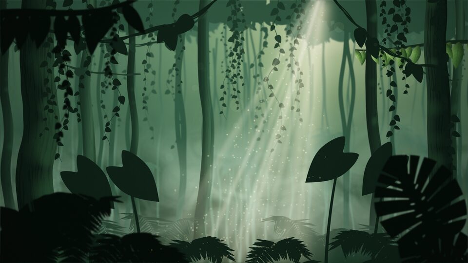
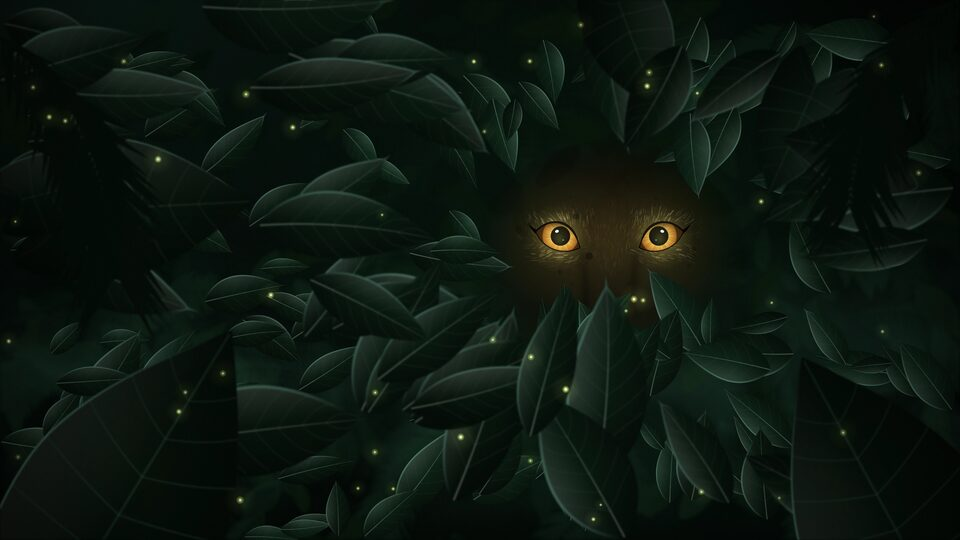
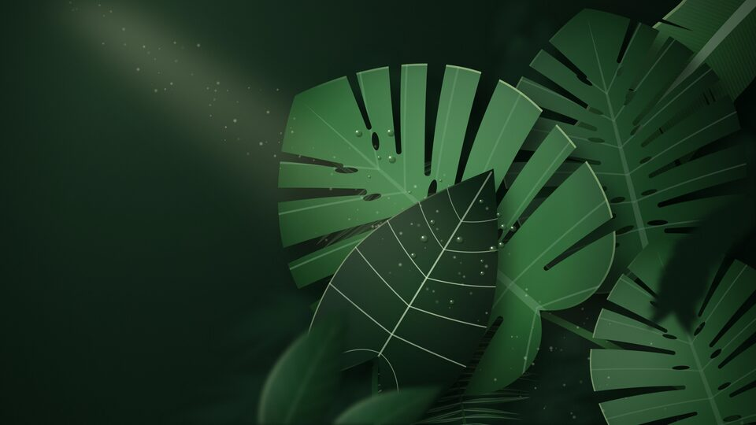
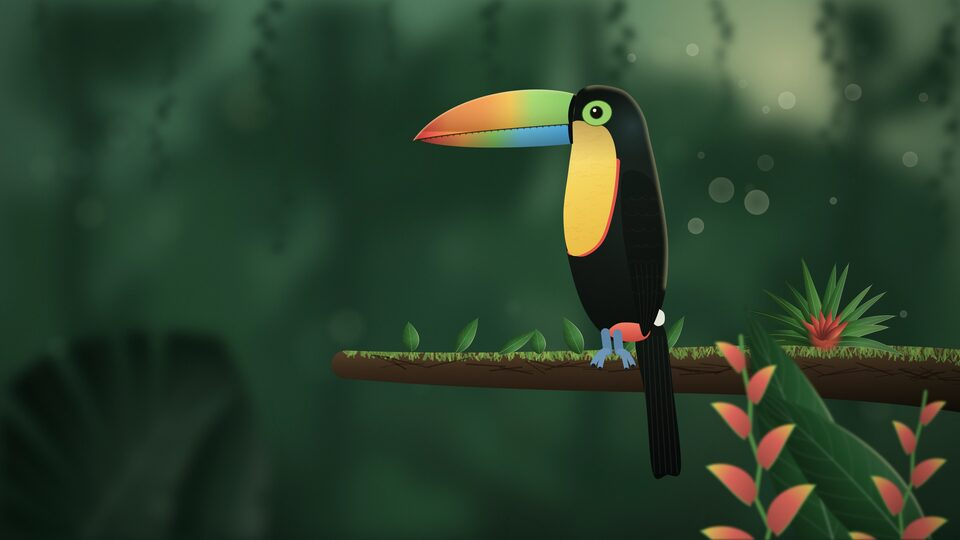
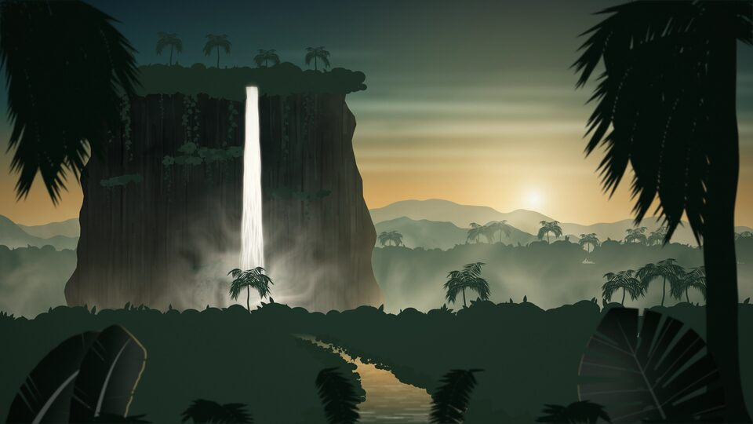
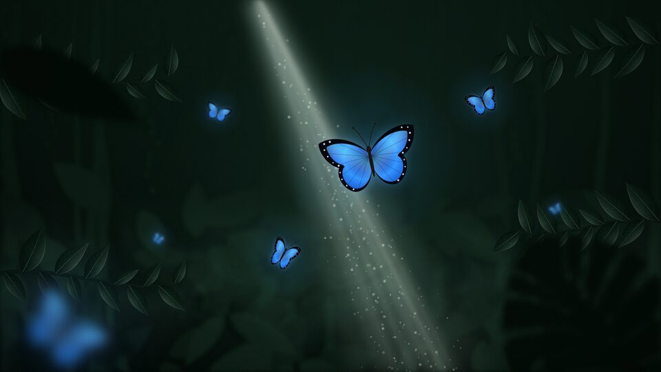
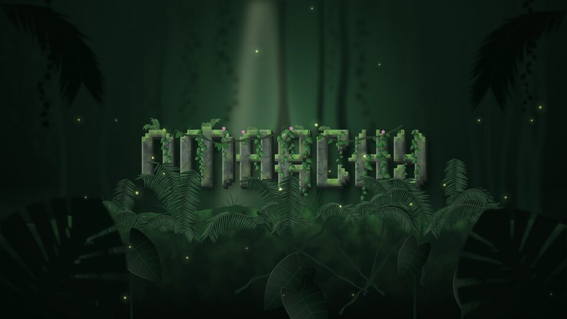

# Jungle

**An Omarchy theme painted from the rainforest:** deep canopy shade, sunlit
leaf greens, and the colours of the creatures hiding in it (jaguar gold,
toucan orange, poison-dart red, morpho blue, orchid pink).

It comes with seven original 4K wallpapers, an animated intro, a custom boot
logo and a hand-tuned btop theme. Every image in this repo was painted in code
from the theme's own palette, and the generator lives in [`art/`](art/).


## Install

```bash
omarchy theme install https://github.com/chrisduvillard/omarchy-jungle-theme
```

Or use the Omarchy menu: **Install › Style › Theme** and paste the URL. The
theme installs as `jungle` and switches to it right away. Pull later updates
with **Update › Extra Themes**.

| | |
|---|---|
| Theme menu | <kbd>Super</kbd> <kbd>Ctrl</kbd> <kbd>Shift</kbd> <kbd>Space</kbd> |
| Next wallpaper | <kbd>Super</kbd> <kbd>Ctrl</kbd> <kbd>Space</kbd> |
| Boot screen logo | **Appearance › Unlock**, then pick Jungle |

## Wallpapers

Three have animals and four don't. All are 3840×2160 WebP.

| | |
|:-:|:-:|
|  **1 · Canopy**<br>Light pouring through layered rainforest. Has an animated intro. |  **2 · The Watcher** 🐆<br>A jaguar's eyes in the night foliage, fireflies drifting. |
|  **3 · Monstera**<br>Glossy leaves and dew in a single beam of light. |  **4 · Toucan** 🦜<br>A keel-billed toucan on a mossy branch, heliconias below. |
|  **5 · Cascade**<br>A ribbon waterfall off a jungle mesa as the sun goes down. |  **6 · Morpho** 🦋<br>Blue morpho butterflies drifting through a shaft of light. |
|  **7 · Overgrown**<br>The Omarchy wordmark as a ruin, reclaimed by moss and vines. |  **Intro**<br>Plays when you switch to Jungle on Canopy: dawn breaks as the camera drifts back through the trees, then hands off to the still. |

The intro respects Omarchy's own switch: it doesn't play when background
intros are turned off or Hyprland animations are disabled.

## Palette


| Role | Colour | |
|---|---|---|
| background | `#0e1d12` | forest floor in deep shade |
| foreground | `#dbe2c7` | pale parchment leaf (13:1 on the background) |
| accent / green | `#85d867` | canopy green, sunlight through a fresh leaf |
| yellow | `#efcc5d` | jaguar gold |
| orange | `#f89b4c` | toucan bill |
| red | `#f06c61` | poison-dart frog |
| cyan | `#5fd2ba` | jungle river |
| blue | `#5cb3e9` | blue morpho |
| magenta | `#df86c7` | orchid |
| muted | `#617c68` | moss (comments, 3.8:1) |

Window borders, menus, notifications and the lock screen share one gradient,
canopy green warming into jaguar gold at 45°
(`hyprland_active_border = "accent yellow 45deg"`).

## What's in the box

| File | What it does |
|---|---|
| `colors.toml` | The palette. Omarchy generates everything else from it: Ghostty, Alacritty, Kitty and Foot, Hyprland borders, the shell (bar, menus, notifications, lock screen), Neovim, VS Code, Helix, tmux, Chromium, Obsidian, keyboard RGB and more, plus GTK dark mode. |
| `btop.theme` | Hand-tuned graphs that climb from river teal through canopy green into gold. |
| `icons.theme` | `Yaru-olive`, the icon set closest to the canopy green. |
| `backgrounds/` | The seven wallpapers, plus `intros/1-canopy.mp4`. |
| `unlock.png`, `preview-unlock.png` | The overgrown stone wordmark for the Plymouth boot screen and login, and its preview. |
| `preview.png` | The theme picker preview. |
| `art/` | The procedural painter behind every image above. |

The theme installs cleanly from git. Omarchy won't take Lua, terminal configs
or `vscode.json` from a git-installed theme, so Jungle ships none of them and
lets `colors.toml` drive those templates instead. Nothing is dropped at install
time.

## The art

Nothing here is a photo or a stock image. The wallpapers are painted by
JavaScript on a canvas in headless Chromium: seeded randomness, simplex noise,
parametric leaves (Monstera fenestrations, torn banana leaves, gravity-bent
palm fronds), fur strokes, iridescent wings, god rays and mist. Every colour
comes from `colors.toml`.

The scenes are resolution independent, so you can repaint them for your own
screen:

```bash
cd art
npm install                          # playwright-core; uses your system Chromium
node render.mjs                      # all wallpapers, 3840x2160 -> ../backgrounds
node render.mjs --size 5120x1440     # ultrawide (or any size)
node render.mjs toucan morpho        # just some of them
node intro.mjs                       # the Canopy intro (needs ffmpeg)
node extras.mjs                      # unlock.png, previews, README images
```

See [`art/README.md`](art/README.md) for how the kit is organised.

## License

[MIT](LICENSE), covering the code and the artwork. The Omarchy wordmark in
*Overgrown* and `unlock.png` belongs to [Omarchy](https://omarchy.org), and is
used here the way Omarchy's built-in themes use it.
